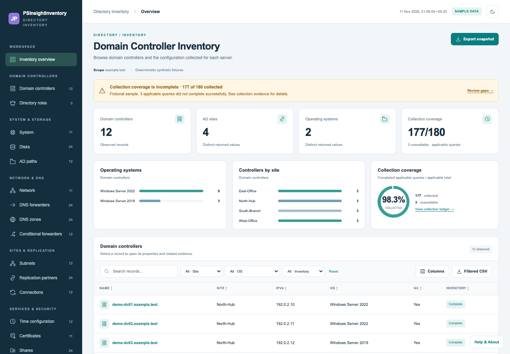
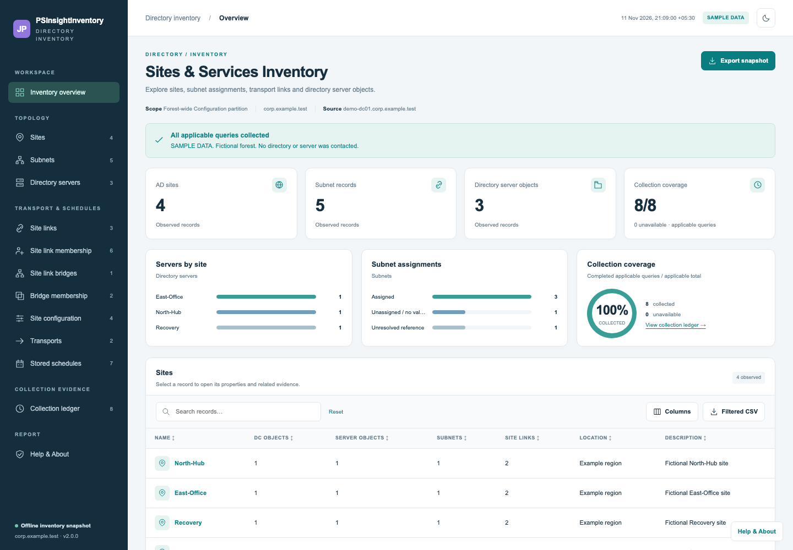
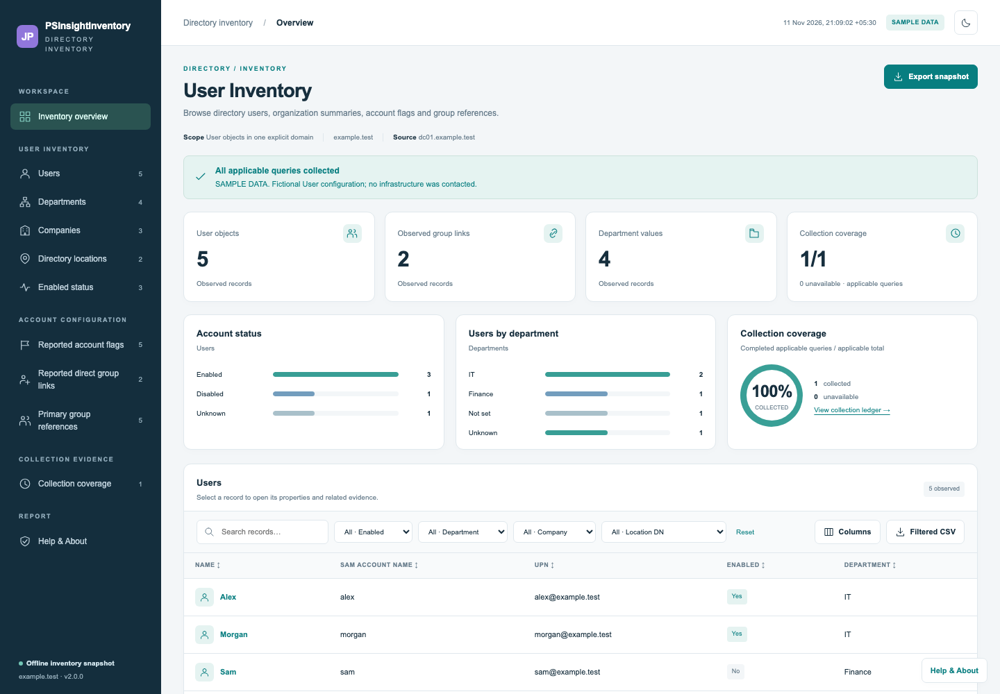

# PSInsightInventory 2.0.0

<p align="center">
  <a href="https://learn.microsoft.com/powershell/"></a>
  
  
  
  
  
  <a href="https://github.com/JP-Repository/PSInsightInventory/releases"></a>
  <a href="VALIDATION.md"></a>
  <a href="LICENSE"></a>
  <a href="https://github.com/JP-Repository/PSInsightInventory/stargazers"></a>
  <a href="https://www.linkedin.com/in/jonathan-preetham"></a>
</p>

Run `Invoke-ADInfrastructureInventory` to collect a **read-only inventory of DCs in one specified domain**. The offline HTML report uses the new Inventory Console layout: grouped navigation, category tables, full controller profiles, search, domain/site filters, sortable columns, pagination, column selection, light/dark themes, CSV and JSON downloads.

This module packages the existing domain-scoped DC inventory engine with the new Inventory Console layout and the original purple **JP** monogram from PSInsightExpl. It runs independently of **PSInsightExpl** and **PSInsightHTML**. Keep the entire `PSInsightInventory` folder together: collectors, template, sample data and branding are bundled. Generated reports embed their assets and remain self-contained offline.

## Installation

Install version 2.0.0 from PowerShell Gallery:

```powershell
Install-Module -Name PSInsightInventory -RequiredVersion 2.0.0 -Scope CurrentUser
Import-Module PSInsightInventory
```

Alternatively, download `PSInsightInventory-2.0.0.zip` from the [GitHub release](https://github.com/JP-Repository/PSInsightInventory/releases/tag/v2.0.0), verify its published SHA-256 checksum, extract the `PSInsightInventory` folder, and import its manifest:

```powershell
Import-Module C:\Tools\PSInsightInventory\PSInsightInventory.psd1 -Force
```

The package is unsigned. Follow your organization’s execution-policy and code-review requirements; the module does not change execution policy or install prerequisites.

## Report previews

These screenshots come from the bundled fictional demo data. They contain no live infrastructure information.

### Domain Controller Infrastructure

<p align="center">
  <a href="Docs/Images/dc-infrastructure-overview.png"></a>
</p>

<details>
<summary><strong>More report screenshots</strong></summary>

### Sites &amp; Services

<p align="center">
  <a href="Docs/Images/sites-and-services-overview.png"></a>
</p>

### User Inventory

<p align="center">
  <a href="Docs/Images/user-inventory-overview.png"></a>
</p>

</details>

## Available commands

| Command | Inventory |
|---|---|
| `Get-PSInsightInventory` | Lists the ten inventories and example commands without collecting data |
| `Invoke-ADInfrastructureInventory` | Domain controllers and infrastructure |
| `Invoke-ADSitesAndServicesInventory` | Forest Sites & Services configuration |
| `Invoke-ADForestInventory` | Forest and domains |
| `Invoke-ADTrustInventory` | Trust configuration observed in local forest domains |
| `Invoke-ADDnsInventory` | DNS configuration |
| `Invoke-ADGroupPolicyInventory` | Group Policy configuration |
| `Invoke-ADOrganizationalUnitInventory` | Organizational units |
| `Invoke-ADComputerInventory` | Directory computer objects |
| `Invoke-ADGroupInventory` | Directory groups and direct relationships |
| `Invoke-ADUserInventory` | Directory user objects |

## Demo mode

Every inventory command supports `-Demo` as an alias for `-SampleData`. Demo mode uses bundled fictional data, does not load Active Directory or DNS modules, and does not contact a domain controller:

```powershell
Invoke-ADInfrastructureInventory -Demo -Open
Invoke-ADGroupPolicyInventory -Demo -Open
Invoke-ADUserInventory -Demo -Quiet
```

## Console display update

Existing inventory commands now show the module name/version, author and MIT license, inventory/domain/output context, native PowerShell progress, elapsed time, observed query outcomes/rows and a final report summary. Unknown totals use an activity indicator rather than a fabricated percentage. Periodic text heartbeats support hosts that hide native progress. Samples are explicitly labeled and do not simulate collection delays.

```powershell
Invoke-ADGroupInventory -Domain child.example.test -Open
Invoke-ADUserInventory -Demo -Open
# Automation: keep the structured result, suppress console decoration.
$result = Invoke-ADUserInventory -Domain child.example.test -Quiet
```

The console uses module text branding; the HTML reports retain JP branding. Repository, documentation and support links are available in HTML Help & About and are not printed in the console banner. See `CONSOLE-DISPLAY.md` and the packaged MIT `LICENSE`.

## AD User Inventory

```powershell
Import-Module .\PSInsightInventory\PSInsightInventory.psd1 -Force
Invoke-ADUserInventory -Demo -Open
Invoke-ADUserInventory -Domain child.example.test -Open
```

Browse user profiles, reported account flags, approximate replicated logon timestamps, reported group links and separate primary-group references. Department/company/location/status summaries open matching users. See `USER-INVENTORY.md` and `Examples/UserSampleOutput/Reports/Users.html`.

The agreed core inventory scope is complete with this release. Subsequent work is limited to user-directed improvements of existing inventories; no further inventory collectors are planned without a new request.

## AD Group Inventory

```powershell
Import-Module .\PSInsightInventory\PSInsightInventory.psd1 -Force
Invoke-ADGroupInventory -Demo -Open
Invoke-ADGroupInventory -Domain child.example.test -Open
```

Browse group properties, direct linked members, local nested and parent relationships, and member-type lookup outcomes. Large lists use ranged LDAP reads; denied lists retain unknown counts. Primary-group membership and recursive/effective access are outside these counts. See `GROUP-INVENTORY.md` and `Examples/GroupSampleOutput/Reports/Groups.html`.

## AD Computer Inventory

```powershell
Import-Module .\PSInsightInventory\PSInsightInventory.psd1 -Force
Invoke-ADComputerInventory -Demo -Open
Invoke-ADComputerInventory -Domain child.example.test -Open
```

Browse computers by reported OS family, server release, version/build, enabled state, DC-role indicator and OU/container location. Click an OS group to open its matching computer list, or select a computer for its SPNs and delegation attributes. This uses directory reads without endpoint connections. See `COMPUTER-INVENTORY.md` and `Examples/ComputerSampleOutput/Reports/Computers.html`.

## DNS zone name servers

```powershell
Import-Module .\PSInsightInventory\PSInsightInventory.psd1 -Force
Invoke-ADDnsInventory -Demo -Open
Invoke-ADDnsInventory -Domain child.example.test -ComputerName DEMO-DC01 -Open
```

DNS Inventory now has 17 sections, including NS records and stored address observations from eligible hosted zones. It captures advertised names without resolution probes or changes, keeps source DC/zone relationships, and records partial failures and external target exclusions. See `DNS-INVENTORY.md` for exact boundaries and the refreshed sample in `Examples/DnsSampleOutput/Reports/Dns-Configuration.html`.

## Organizational Unit Inventory

```powershell
Import-Module .\PSInsightInventory\PSInsightInventory.psd1 -Force
Invoke-ADOrganizationalUnitInventory -Demo -Open
Invoke-ADOrganizationalUnitInventory -Domain child.example.test -Open
```

Browse OU hierarchy branches, direct/descendant object counts, direct GPO references, deletion protection and reported delegation ACEs. Select an OU to see related configuration and collection records together. Unknown counts and denied DACLs remain explicit. See `ORGANIZATIONAL-UNIT-INVENTORY.md` and `Examples/OrganizationalUnitSampleOutput/Reports/Organizational-Units.html`.

## Group Policy Inventory

```powershell
Import-Module .\PSInsightInventory\PSInsightInventory.psd1 -Force
Invoke-ADGroupPolicyInventory -Demo -Open
Invoke-ADGroupPolicyInventory -Domain child.example.test -Open
```

Browse GPO properties, versions, links, reported permissions, WMI filters/references and settings structure in an 11-section report. Open a GPO to inspect its related records and collection outcomes. This is configuration inventory with no scoring or recommendations. Settings values and raw XML are omitted; see `GROUP-POLICY-INVENTORY.md` for exact scope and limitations. Open `Examples/GroupPolicySampleOutput/Reports/Group-Policy.html` for the offline sample.

## DNS Configuration Inventory

```powershell
Import-Module .\PSInsightInventory\PSInsightInventory.psd1 -Force
Invoke-ADDnsInventory -Demo -Open
Invoke-ADDnsInventory -Domain child.example.test -ComputerName DEMO-DC01 -Open
```

Captures client resolvers, DNS server settings, zones, conditional forwarders, primary-zone aging, delegations and scopes, with separate category and per-zone collection evidence. Successful zone data survives a partial collection. See `DNS-INVENTORY.md` and the offline report in `Examples/DnsSampleOutput/Reports/Dns-Configuration.html`.

## Trust inventory

```powershell
Import-Module .\PSInsightInventory\PSInsightInventory.psd1 -Force
Invoke-ADTrustInventory -Demo -Open
Invoke-ADTrustInventory -Domain child.example.test -Open
```

The new command reads trusted-domain objects observed in the local forest member domains. It captures direction relative to each observed domain, reported protocol/transitivity, selective authentication, separate SID-filtering properties and raw configuration flags. It does not contact trust partners or validate/reset trusts.

See `TRUST-INVENTORY.md`. A complete sample run is in `Examples/TrustSampleOutput/`.

## Forest & Domain inventory

```powershell
Import-Module .\PSInsightInventory\PSInsightInventory.psd1 -Force
Invoke-ADForestInventory -Demo -Open
Invoke-ADForestInventory -Domain child.example.test -Open
```

The connection domain is the starting point. This command inventories the forest and its returned member domains, including functional levels, hierarchy, configured UPN/SPN suffixes, FSMO owners, partition references, hosted naming contexts, default containers, server references and default domain password policies. Failed domain queries retain the domain row with unknown values and an explicit collection status.

See `FOREST-INVENTORY.md`. The generated example is `Examples/ForestSampleOutput/Reports/Forest-And-Domains.html`.

## Sites & Services inventory

After importing the module, preview or collect the new inventory:

```powershell
Invoke-ADSitesAndServicesInventory -Demo -Open
Invoke-ADSitesAndServicesInventory -Domain child.example.test -Open
```

The supplied domain selects the connection DC. **Sites & Services configuration is forest-wide**, so this command reports the forest Configuration partition, including sites with no DC objects, all returned subnet objects, links, bridges, server objects, ISTG settings, transport options and stored schedules. It uses directory reads through one pinned DC and does not require WinRM.

See `SITES-AND-SERVICES.md` for scope, columns, schedules and limitations. A generated report is in `Examples/SitesAndServicesSampleOutput/Reports/Sites-And-Services.html`.

## Quick start

Extract the ZIP into a folder such as `C:\Scripts`. From the folder containing `PSInsightInventory`, import the manifest:

```powershell
Import-Module .\PSInsightInventory\PSInsightInventory.psd1 -Force
```

Or use the full path:

```powershell
Import-Module C:\Scripts\PSInsightInventory\PSInsightInventory.psd1 -Force
```

If the `PSInsightInventory` folder is installed in a directory on `$env:PSModulePath`, import it by name:

```powershell
Import-Module PSInsightInventory
```

Follow your organization's policy for downloaded, unsigned modules. This package does not change execution policy or install itself.

## Discover commands and examples

```powershell
Get-Command -Module PSInsightInventory
Get-PSInsightInventory | Format-List *
Get-Help Invoke-ADInfrastructureInventory -Examples
Get-Help Invoke-ADInfrastructureInventory -Full
```

The module exports `Get-PSInsightInventory`, `Invoke-ADInfrastructureInventory`, `Invoke-ADSitesAndServicesInventory`, `Invoke-ADForestInventory`, `Invoke-ADTrustInventory`, `Invoke-ADDnsInventory`, `Invoke-ADGroupPolicyInventory`, `Invoke-ADOrganizationalUnitInventory`, `Invoke-ADComputerInventory`, `Invoke-ADGroupInventory`, and `Invoke-ADUserInventory`. Import and catalog discovery do not collect data or load the AD module. `-Demo` is an alias for `-SampleData`, matching the familiar demo usage in PSInsightExpl.

Preview with fictional data, without contacting AD or any server:

```powershell
Invoke-ADInfrastructureInventory -SampleData -Open
```

Inventory the child domain:

```powershell
Invoke-ADInfrastructureInventory -Domain child.example.test -Open
```

Inventory only the root domain's DCs:

```powershell
Invoke-ADInfrastructureInventory -Domain example.test -Open
```

The root-domain command does **not** enumerate child-domain DCs. A scope mismatch during discovery stops the run.

Start with one DC before the full-domain run:

```powershell
Invoke-ADInfrastructureInventory `
    -Domain child.example.test `
    -ComputerName DEMO-DC01 `
    -OutputPath C:\Temp\Reports `
    -Open
```

`ComputerName` accepts exact short names or FQDNs present in the discovered domain inventory. It supports an array, deduplicates matches and rejects wildcards and out-of-domain targets.

Use a different authorized credential:

```powershell
$inventoryCredential = Get-Credential
Invoke-ADInfrastructureInventory -Domain child.example.test -Credential $inventoryCredential -Open
```

Collect only directory categories when WinRM is unavailable:

```powershell
Invoke-ADInfrastructureInventory -Domain child.example.test -SkipRemote -Open
```

Remote categories are then recorded as `NotAttempted`, and overall inventory remains `Partial`. The script does not configure remoting or retry with another protocol.

Adjust concurrency or timeout budgets:

```powershell
Invoke-ADInfrastructureInventory `
    -Domain child.example.test `
    -ThrottleLimit 4 `
    -TargetTimeoutSeconds 240 `
    -DiscoveryTimeoutSeconds 90 `
    -OpenTimeoutSeconds 15 `
    -Open
```

Use an existing HTTPS endpoint with normal certificate validation:

```powershell
Invoke-ADInfrastructureInventory -Domain child.example.test -UseSSL -Open
```

`-Port` can select an approved custom WinRM port. The default is 5985, or 5986 with `-UseSSL`. Authentication is Kerberos; the script does not enable CredSSP, Basic authentication, TrustedHosts or certificate-validation exceptions.

## Prerequisites

| Location | Requirement |
|---|---|
| Collector | Windows PowerShell 5.1, RSAT `ActiveDirectory` module, domain connectivity and DNS resolution |
| Account | Permission to read directory/topology information and to use the target PowerShell endpoint and local providers |
| Target DCs | Existing Windows PowerShell WinRM endpoint accessible to the account |
| DNS-hosting DCs | Local `DnsServer` module for DNS configuration reads |
| Sample mode | PowerShell 5.1 or later; no AD/DNS modules, DC access or network connection required |

Typical DC endpoint permissions are administrative unless your organization has delegated the necessary access. Directory read access alone does not imply permission to read remote system, DNS, registry or certificate metadata. Use an account approved for this reporting task.

## Permissions and read-only behavior

Collection uses directory, DNS, Group Policy, registry, certificate-store and CIM/WinRM read operations appropriate to the selected inventory. PSInsightInventory does not create, modify or delete AD, DNS, GPO, OU, computer, group, user, trust, site or endpoint configuration. It does not enable remoting, alter TrustedHosts, bypass certificate validation, export private keys, reset trusts, send email or perform remediation.

Use a least-privilege account approved for the required reads. Some remote DC categories commonly require administrative or specifically delegated endpoint access. Missing permission is recorded as failed, partial or unknown evidence rather than being treated as a healthy or empty result.

The collector uses normal AD/DC discovery and authentication traffic, including DNS, Kerberos and AD Web Services (TCP 9389). Remote local-provider reads use WinRM TCP 5985/5986 or the selected port. CIM queries execute **inside** the target session; this script does not use a remote DCOM fallback. Existing DC-to-DC replication traffic is a separate network path.

## All 17 report sections

| Section | Inventory captured |
|---|---|
| Inventory overview | Controller/domain/site counts, OS/site distributions, collection coverage |
| DCs | FQDN, domain, AD site, IPv4/IPv6, OS/version, GC, writable/RODC, completeness |
| System | Manufacturer/model, logical processors, memory, OS build/version, boot time, uptime |
| Disks | Fixed logical volumes, labels, capacity, free space, filesystem |
| AD paths | NTDS database/log paths and configured SYSVOL path |
| Network | IP-enabled adapters, IPv4/IPv6, masks/prefixes, gateways, DHCP, MAC, interface index, ordered DNS resolvers |
| Forwarders | Server-level DNS forwarders, configured order, timeout, root-hint setting, DNS service state |
| Zones | Non-forwarder zones, type, AD integration, directory partition, dynamic updates, reverse lookup flag |
| Conditional forwarders | Namespace, master-server addresses, AD integration, directory partition, timeout, recursion setting |
| Subnets | Subnet objects assigned to each DC's AD site, description/location, site DN |
| Partners | Inbound replication partners across hosted partitions and returned replication metadata |
| Connections | Inbound nTDSConnection objects below that DC, source DN, KCC flag, enabled flag, transport DN |
| Time | Configured W32Time type, NTP setting, announce flags, reported current source |
| Roles | FSMO assignments from controller discovery |
| Certificates | LocalMachine\My subject, issuer, template text/OID, validity dates, thumbprint, EKU and private-key presence flag |
| Shares | Share name, path, description and type; no share contents |
| Collection | Per-controller/category status, method, timestamps, duration, row count and error details |

All records use the DC FQDN as `Name` so that summary, details and ledger rows join consistently. Multiple adapters, disks, certificates, shares and replication partners are retained as separate records.

DNS client **Preferred DNS**, **Alternate DNS** and **Additional DNS** describe the ordered resolver configuration on an adapter. They are separate from **server-level forwarders** and **conditional forwarders**. Resolver values use `Win32_NetworkAdapterConfiguration.DNSServerSearchOrder`; the full list is retained. Masks/prefixes correspond to the original provider's address ordering.

Subnet rows describe objects assigned to the DC's **AD site**, repeated per observing DC. They do not prove the DC's IP belongs to that subnet. Replication connection source/transport values are preserved as DNs instead of guessed names. Partner metadata is retained as inventory evidence; the report does not calculate a DC health verdict or determine a root cause.

Certificate inventory reads only the `LocalMachine\My` store. It does not export certificates/private keys, inspect every store, validate certificate chains or confirm which certificate a service is using. Template text depends on extension format and OS language. If a property was not returned, it remains null/Unknown rather than a fabricated value.

## Coverage and errors

There are **15 category operations per selected DC**: discovery identity plus 14 worker categories. Overview and Collection are derived views, so 17 navigation sections do not mean 17 checks.

| Status | Meaning |
|---|---|
| Succeeded / Collected | Query completed, including a legitimate zero-row result |
| Failed | Query or access failed; inspect Error ID and Message |
| TimedOut | Worker budget expired before this category completed |
| NotAttempted | Remote collection was explicitly excluded with `-SkipRemote` |
| NotApplicable | DNS Server service is absent, so that DNS category does not apply |

A DC is `Complete` only when every category succeeded or was explicitly not applicable. All other combinations are `Partial`. These labels describe **inventory completeness**, not operational health. Service-manager access denial is reported as failure, not mistaken for an absent DNS role.

The overview's percentage uses successful operations divided by applicable operations, excluding `NotApplicable`. `NotAttempted` remains unavailable. Controller completeness includes all categories. Category coverage summaries describe the whole snapshot; search/site filters narrow table rows. The collection ledger and `Coverage.csv` provide the underlying counts.

`TargetTimeoutSeconds` applies to the complete worker, including startup, directory reads and remote collection. It is not a separate budget for each category. Envelopes stream as categories finish, and those completed results survive a later timeout. `OpenTimeoutSeconds` controls connection opening; WinRM `OperationTimeout` is not a remote command execution deadline. Cancellation/cleanup can add time after a budget expires. Discovery has its own budget.

The script continues independent targets after per-category/target collection failures. Discovery, output, normalization or rendering errors stop the run and are logged. Interrupting a run can leave logs without a final report; previously completed run folders are preserved.

## Output

Default parent: `C:\Temp\Reports`. Each run creates:

```text
PSInsightInventory_Infrastructure_<yyyy-MM-dd>
    Reports
        DC-Inventory_<yyyy-MM-dd>.html
        DC-Inventory_<yyyy-MM-dd>.json
        CSV
            dcs.csv, system.csv, disks.csv, paths.csv, network.csv
            forwarders.csv, zones.csv, conditional.csv, subnets.csv
            partners.csv, connections.csv, time.csv, roles.csv
            certificates.csv, shares.csv, collection.csv, Coverage.csv
    Logs
        PSInsightInventory_<yyyy-MM-dd>.jsonl
```

The date is the collection host’s local date at startup. A repeat run on the same date adds a folder suffix such as `_02` so reports from earlier runs are preserved.

The final PowerShell object gives module name/version, inventory ID, exact paths, counts and RunId. No retention deletion occurs. `-Open` opens the saved HTML locally; it does not run collection again.

The offline HTML embeds all assets and data. Use a current Edge/Chrome browser for the full console. When JavaScript is disabled, static category tables remain readable. Browser CSV exports contain **all filtered rows and all schema columns**, including rows beyond the current page and columns hidden on screen. JSON exports contain the entire snapshot, independent of table filters.

On-disk CSV and browser CSV neutralize strings beginning with spreadsheet formula characters by prefixing an apostrophe. Raw values remain unchanged in JSON and encoded HTML. CSV files are UTF-8; every dataset has headers even when no rows exist. JSONL logs record run/phase/target/operation/outcome/duration/error context, never credential objects or secret values.

## Included files and validation

- `PSInsightInventory.psd1` / `.psm1`: manifest and module entry point.
- `Public/`: inventory entry command and catalog command.
- `Private/`: execution engine and independent directory/remote collectors.
- `Templates/Dashboard.html` and `Assets/Dashboard.*`: shared offline dashboard for all ten inventories.
- `Assets/JP.brand.css`: the reused Explorer JP monogram styling.
- `Assets/DCInventory.sample.json`: deterministic fictional fixtures.
- `Examples/SampleOutput/`: a full sample run generated by the public module command.
- `Tests/`: module and collector regression checks; no Pester dependency.
- `BRANDING.md`: logo provenance and source hashes.
- `VALIDATION.md`: completed checks and outstanding Windows/live/visual validation.

From the parent folder, run the offline tests:

```powershell
.\PSInsightInventory\Tests\Test-PSInsightInventory.ps1
.\PSInsightInventory\Tests\Test-InventoryEngine.ps1
.\PSInsightInventory\Tests\Test-SitesAndServices.ps1
.\PSInsightInventory\Tests\Test-ForestInventory.ps1
.\PSInsightInventory\Tests\Test-TrustInventory.ps1
.\PSInsightInventory\Tests\Test-DnsInventory.ps1
.\PSInsightInventory\Tests\Test-GroupPolicyInventory.ps1
.\PSInsightInventory\Tests\Test-OrganizationalUnitInventory.ps1
.\PSInsightInventory\Tests\Test-ComputerInventory.ps1
.\PSInsightInventory\Tests\Test-GroupInventory.ps1
.\PSInsightInventory\Tests\Test-UserInventory.ps1
```

These tests use fictional data and mocked providers; they do not contact infrastructure. They create local report/log files and harmless local jobs. The scheduler test cancels a deliberately stalled job after a short budget.

The module targets Windows PowerShell 5.1. Release-candidate offline validation used PowerShell 7.6.8 on macOS. Native Windows PowerShell 5.1 and a live AD pilot remain pending. Use the one-DC command above and inspect Collection before expanding.

Version 2.0.0 uses the shared dashboard across DC, Sites & Services, Forest & Domain, Trust, DNS configuration, Group Policy, OU, Computer, Group, and User inventories. The JSON file beside each report preserves the full snapshot including raw evidence where available. Filtered CSV contains all matching records and schema columns. All ten fictional examples are included under Examples.

## Troubleshooting

- **Module does not import:** keep the complete folder structure together and import `PSInsightInventory.psd1`, not an individual public script.
- **Command is not found:** run `Import-Module PSInsightInventory -Force`, then confirm the 11 exports with `Get-Command -Module PSInsightInventory`.
- **ActiveDirectory or GroupPolicy command is unavailable:** install the applicable Windows RSAT feature and run the live command from Windows PowerShell 5.1.
- **A live inventory is partial:** open the Collection section and JSONL log. Access denial, unavailable provider, timeout and intentionally skipped work remain distinct outcomes.
- **WinRM collection fails:** confirm the existing approved endpoint, Kerberos/DNS resolution, firewall path and account authorization. The module does not change remoting configuration.
- **The report does not open automatically:** omit `-Open` and open the returned `HtmlReport` path manually in a current Edge or Chrome browser.
- **Automation receives console decoration:** use `-Quiet`; structured results remain on the success stream.
- **PowerShell Gallery install returns an older version:** request version 2.0.0 explicitly and verify with `Get-Module PSInsightInventory -ListAvailable`.

## Microsoft command references

- [Get-ADDomainController](https://learn.microsoft.com/en-us/powershell/module/activedirectory/get-addomaincontroller)
- [Get-ADReplicationPartnerMetadata](https://learn.microsoft.com/en-us/powershell/module/activedirectory/get-adreplicationpartnermetadata)
- [Get-ADReplicationSubnet](https://learn.microsoft.com/en-us/powershell/module/activedirectory/get-adreplicationsubnet)
- [Get-DnsServerForwarder](https://learn.microsoft.com/en-us/powershell/module/dnsserver/get-dnsserverforwarder)
- [Get-DnsServerZone](https://learn.microsoft.com/en-us/powershell/module/dnsserver/get-dnsserverzone)
- [DNS forwarding and conditional-forwarder queries](https://learn.microsoft.com/en-us/windows-server/networking/dns/configure-dns-forwarding)
- [New-PSSessionOption timeout semantics](https://learn.microsoft.com/en-us/powershell/module/microsoft.powershell.core/new-pssessionoption)
